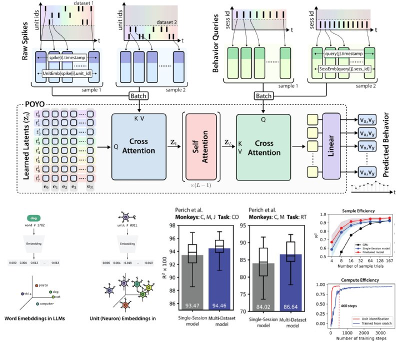
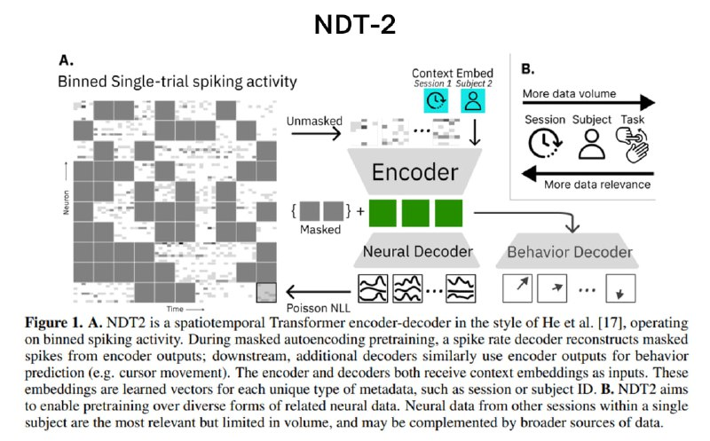
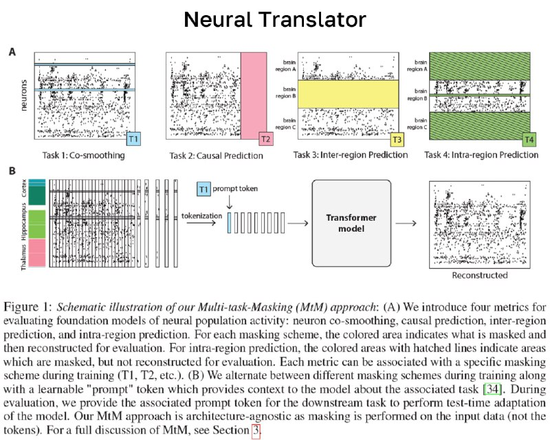

I want to talk about the models people now use to decode brain signals (spikes, LFP). Let's look at how they are trained on data from different sessions and animals, which pretraining approaches they use, and which architectures are in use. I picked three interesting papers, briefly about each.

- [POYO-1: A Unified, Scalable Framework for Neural Population Decoding](https://poyo-brain.github.io/). Perceiver IO where the tokens are individual spikes, trained with supervision on different animals solving different tasks.
- [Neural Data Transformer 2: Multi-context Pretraining for Neural Spiking Activity](https://www.biorxiv.org/content/10.1101/2023.09.18.558113v1). They adapted the masked autoencoder (MAE), and they also add information about the session and the subject. MAE is cool and simple.
- [Towards a "universal translator" for neural dynamics at single-cell, single-spike resolution](https://arxiv.org/abs/2407.14668). They extended the previous approach and made a smarter pretraining: they add tokens about the masking type. They showed it got better.

What trend do we see? Multi-task, multi-subject, multi-session, multi-multi. Transformers go brr... In short, people take a transformer and want it to solve everything for everyone.

The data are different everywhere, so comparing side by side is still hard. All of this is more to get familiar with how you can work with the data. So take inspiration for your own work.

**Just my thought.** A transformer works with vectors. So to feed our neural data into it, we first have to turn them into vectors. But what counts as a token for neural activity? Single spikes, binned activity, a group of neurons, etc. This is an open question, and you can do it in different ways. But what if we compress the information first, and use more useful tokens from our "compressor"? For example VQ-VAE, which is now used for all audio tasks, and for images and video too. Why should neuro be worse?

## Paper 1: POYO-1

POYO: a supervised, multi-session, multi-subject, multi-task transformer. They had several monkeys that were asked to do simple motor tasks. In the authors' words: "In total, we aggregated 178 sessions worth of data, spanning 29,453 units from the primary motor (M1), premotor (PMd), and primary somatosensory (S1) regions in the cortex of 9 nonhuman primates."

[paper](https://arxiv.org/abs/2310.16046) · [amazing visualization](https://poyo-brain.github.io/)

**How it works.** For such a diverse dataset people usually take regressions or RNNs and train them separately for each animal and even for each session. They decided to go further: we have a transformer, let's put everything into it and see what happens. But if you put it in naively, you get a naive result. So they went further here too. The usual practice is to take spikes, count them in small windows (for example 20 ms) and work with rate coding.

The authors dropped this and work with spikes directly. We have spikes of neurons at different moments in time. THIS WILL BE OUR TOKEN. Each token carries information about the time and about the neuron (neuron 1 or neuron 10 is a big difference). So there are as many tokens as there were spikes.

What if we recorded many neurons? Or they spike a lot at some moment? Here the Perceiver comes in. It is an architecture that helps reduce the number of tokens to the number we need, for example 256.

How does it work? Through learnable queries. Take 256 learnable queries and put them into cross-attention. The tokens from the brain are the keys and values. So we sort of string our set of spikes onto 256 vectors, a kind of smart merging. Then we work with the latents. The idea is not new, but it is great.

The rest is simple. Self-attention on these latent vectors. Then they do the same trick again and string these 256 vectors onto the vectors of some task, with time. There can be 25 of them, or 1000, any number. And we get a prediction. Then we compute the losses and enjoy life.

I would extend the idea and do pretraining. They trained this model in supervised mode, so there was always a target. What if we collected 10 times more raw data without labels and pretrained this thing? We could also try something like MAE: reconstruct the missing tokens. Would it improve things or not?

Be sure to look at their visualizations. They are very good, the authors clearly put a lot of work into them.

## Paper 2: NDT2

Neural Data Transformer 2: Multi-context Pretraining for Neural Spiking Activity.

In short: they applied MAE to neural spikes and added information about the session and the subject. The result is an advanced neural decoder. [paper](https://www.biorxiv.org/content/10.1101/2023.09.18.558113v1)

**How it works.**
1. Split brain activity into 20 ms bins. Basically rate coding.
2. Group neurons into "patches", like pixels in vision transformers.
3. Add information about the subject and the session. Context plays a key role.
4. Pretrain with MAE.

**My thought:** it seems the different channels should be merged adaptively somehow. They just concatenated them. Here the Perceiver looks promising.

P.S. MAE pretraining really works! We tried it for EMG. And if you add information about the person, it also starts to work better.

## Paper 3: the "universal translator" (MtM)

Towards a "universal translator" for neural dynamics at single-cell, single-spike resolution.

In short: they improved pretraining on neural data by changing the masking. [paper](https://arxiv.org/abs/2407.14668)

**What data they use.**
- They recorded with Neuropixels, placed in several regions, and asked 48 animals to do different tasks.
- Areas: secondary visual areas, hippocampus and thalamus.

**How the model works.**
- They use rate coding and the NDT-1 and NDT-2 models.
- They came up with multi-task masking (MtM): the model learns by alternately masking and reconstructing activity in time, across neurons and across brain areas.
- A learnable token tells the model the current masking scheme.

**In plain words.** They looked at how NDT-2 works and decided that you can mask areas not completely at random but in a more meaningful way. So they came up with different masking schemes: predict the future, other areas, missing neurons. On top of that, each masking type has its own hint token, which they used to help the MAE reconstruct better.

In the end it got better, otherwise there would be no paper.

**My thoughts.** If you draw parallels with the previous papers, this is a mix of POYO and NDT. In POYO different supervised tasks were encoded as tokens. Here they adapted this for the masked task, and used NDT as the architecture.

To me the approach is interesting, but not a big breakthrough. In my view, predicting the future is a hard task on its own, and it may be enough. But I may be wrong, of course, this needs testing. The hard question is tokenization: how to do it? Imagine we have not 100 neurons but 1000 or 10,000. How do you work with that?

What do you think about all these models? Let's discuss.
