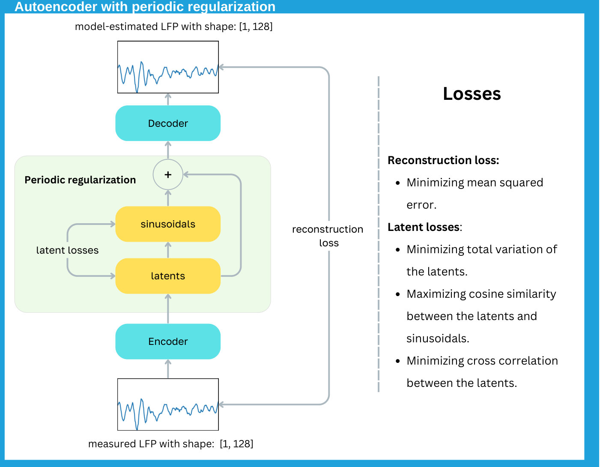
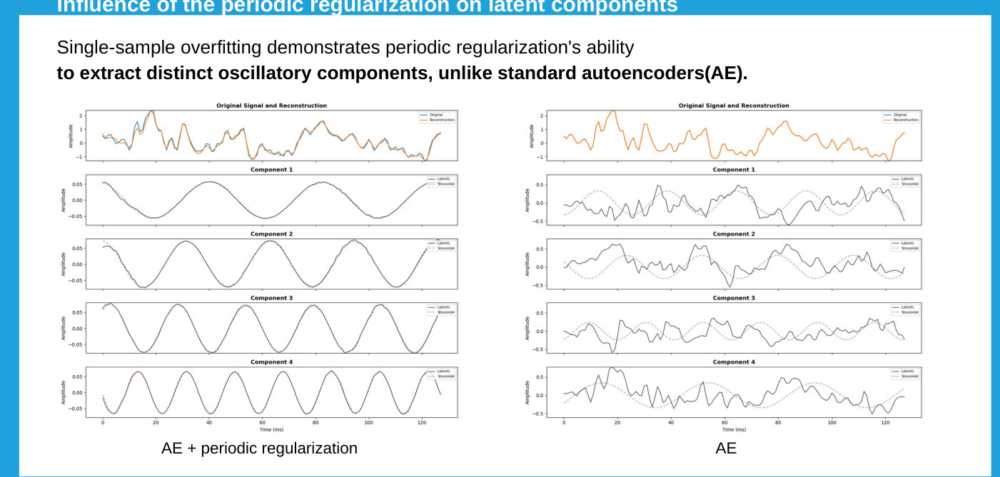

I want to tell you how I made a poster for SfN 24 in Chicago together with the University of Utah, but never went to the US.

A. Kovalev, K. Clark, G. Weng, A. Akbarian, B. Noudoost, N. Nategh. University of Utah. Neuroscience 2024, poster PSTR383.04. <a href="/img/sfn-2024/kovalev-sfn-2024-poster.pdf">Full poster (PDF)</a>

## Background

In spring I got an unexpected offer from the University of Utah: a PhD researcher position with Neda Nategh. I accepted, and already in May we thought it would be cool to start doing something before the studies (August). So we right away submitted an abstract to SfN 24 (the largest neuroscience conference).

I'll say it right away: it is great motivation not to drop a project when you submit an abstract with only a sketch of the future work.

For me it was a great chance to get into the topic quickly and meet cool people at the conference. Nice, I thought, I had never been to such a conference in person.

## The context of the work

My advisor has worked in computational neuroscience for a long time. Her lab studies how information is encoded in the visual cortex of monkeys (and not only there). She holds that the firing rate alone is not enough to encode all the information. There are other mechanisms, for example phase coding.

In simple words: it matters not only how often a neuron spikes, but also when the spikes happen relative to some common signal (a reference). Phase coding shows when the neuron fired relative to the reference (in which phase of this signal).

So we need to learn to extract this periodic (reference) signal from the LFP. Standard frequency decomposition does not work very well here because of the different sources and the noise.

It would be great if a model learned to extract good periodic components by itself. Then we would also test phase coding on them.

## Research

So I went to look at what deep learning has for this.

We need to split a 1D signal into N components while keeping the time resolution. So (1, Time) → (N, Time).

The first thing that comes to mind: let's train an autoencoder. Pass the signal through an encoder and decoder and reconstruct the original.

Obviously, done head-on this gives nothing: your components will just repeat the input signal. You can add different noise to the input and reconstruct the original signal. In my case it did not work: my components looked like a smoothed input signal. Various sparse regularizations did not give what I wanted either.

**About DeepPhase.** By chance I came across [DeepPhase](https://doi.org/10.1145/3528223.3530178) ([my post about it, RU](https://t.me/neural_cell/162)), and off it went. In short, they added a sinusoidal approximation for the components and used these sinusoids as the input to the decoder. As a result they always have a periodic signal and can extract phase information. The results look great.

I tried to do the same. It came out fun, but the reconstruction was really poor. Plus it was hard to get temporal coherence.

So, based on this idea, I decided to make it a regularization: directly force our latents to be similar to sinusoids. And feed the decoder not only the sinusoids, but a weighted average of the sinusoids and the latents.

This way the encoder returns latents that look like sinusoids. At test time the approximation part could then be removed.

**What we do:** we force an autoencoder (AE) to learn meaningful components from LFP signals.

**How it works.** We implement a periodic regularization module:
- decompose the LFP into components with the encoder
- apply a sinusoidal approximation to each component (torch.fft)
- push our latents to be similar to the approximation and independent from each other
- a random weighted average of the latents and the sinusoids goes to the decoder

**Architecture.** An AE with residual conv layers and periodic regularization of the latent space.

**Our losses:**
- reconstruction loss: MSE
- TV loss to force the latents to be smooth
- maximizing the cosine similarity between the latents and the sinusoids
- minimizing the cross-correlation of the latents

## Result

It started to work. The signal is reconstructed, and the components look periodic and different from each other. It came out interesting, but still raw.

**My thoughts.** We got a frequency decomposition not of the input data, but of some nonlinear features of the input data. That's the most interesting part, in my view.

For sure, it needs improvements. The model needs to use context information about sessions and electrodes. It should also work with all electrodes at once, so we could reduce the dimensionality.

## About the US

In June I was sent to administrative processing after just a couple of questions at the consulate in Serbia. Silence since then. So I did not go to the US, and I never started that PhD. But a nice poster came out of it. Not bad either.
