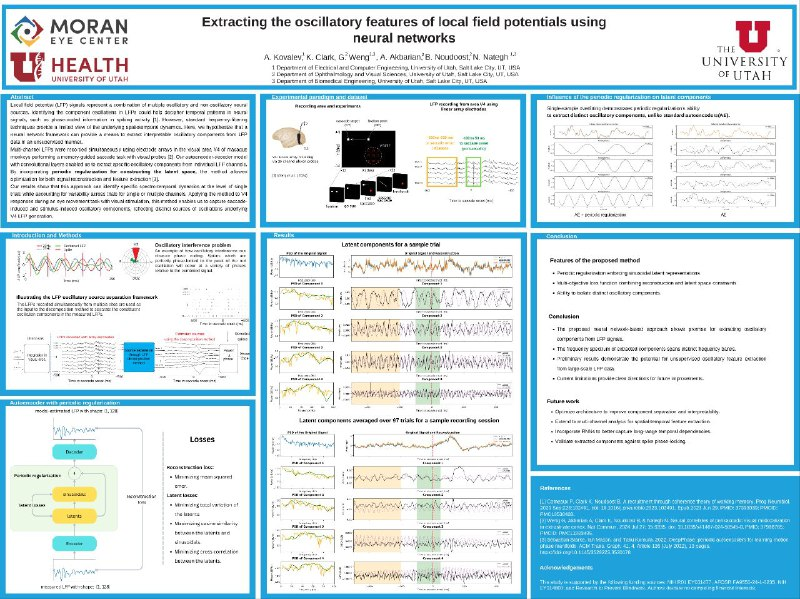

I'm happy to tell you about my poster from SfN 24.

A. Kovalev, K. Clark, G. Weng, A. Akbarian, B. Noudoost, N. Nategh. University of Utah. Neuroscience 2024, poster PSTR383.04.

**What:** we force an autoencoder (AE) to learn meaningful components from LFP signals.

**How it works.** We implement a periodic regularization module:
- decompose the LFP into components with the encoder
- apply a sinusoidal approximation to each component (torch.fft)
- push our latents to be similar to the approximation and independent from each other
- a random weighted average of the latents and the sinusoids goes to the decoder

**Architecture.** An AE with residual conv layers and periodic regularization of the latent space.

**Our losses:**
- reconstruction loss: MSE
- TV loss to force the latents to be smooth
- maximizing the cosine similarity between the latents and the sinusoids
- minimizing the cross-correlation of the latents

**My thoughts.** We got a frequency decomposition not of the input data, but of some nonlinear features of the input data. That's the most interesting part, in my view.

For sure, it needs improvements. The model needs to use context information about sessions and electrodes. It should also work with all electrodes at once, so we could reduce the dimensionality.
