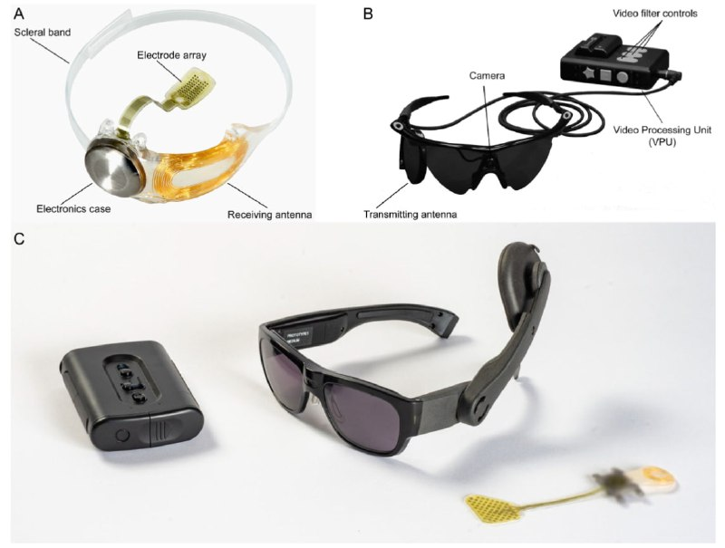

People with visual neural implants almost never use them in real life.

The researchers interviewed 6 developers and 6 users of the Argus II and Orion implants. The sample looks small, but it is 1.5% of all Argus II users in the world and 67% of Orion users. So the data are fairly representative.

It turned out that developers strongly overrate how useful these devices are. The users themselves say they are inconvenient, "bad", and almost useless in real life.

As often happens, reality and expectations don't match. Let's go through them.

## Reality
1. They are practically not used for everyday tasks
2. Most users rely on methods they already know (apps, canes, guide dogs)
3. Some users stopped using the implants altogether, because they manage faster without them
4. The only frequent use is social interaction (noticing that someone approached or is moving nearby)

## What users actually want
1. Better quality of "vision": reading text, recognizing faces, colors, depth
2. Integration with modern technology
3. Real independence in everyday life

The main lesson: however excited you are about your technology, first make sure it actually solves users' problems. Otherwise you risk doing something noble but useless. This of course doesn't apply to fundamental research: studying how the brain works is useful anyway. But building a product nobody uses is a waste of resources.

Paper: [Aligning Visual Prosthetic Development With Implantee Needs](https://tvst.arvojournals.org/article.aspx?articleid=2802271)

## More details
Finally, a bit more information. My bro Claude made a short summary of the paper to save you time.

**Current capabilities of the prostheses:**
- Argus II: 60 electrodes on the retina, gives very basic "vision": users see flashes of light (phosphenes)
- Basic navigation: telling apart high-contrast objects, detecting the direction of motion
- At most, help with orientation and detecting large objects
- Resolution is very low: you can't read text or tell faces apart

**What stands in the way of independence:**

1. Technical limitations:
- The device needs an external camera on glasses
- It needs a processor worn on the belt
- Wires and cables get in the way of movement
- The battery needs frequent charging

2. Functional limitations:
- You can't read labels, price tags or documents on your own
- Colors and small details are hard to tell apart
- Problems with judging depth and distance
- Hard to use in low contrast

3. Practical problems:
- The device makes tasks slower compared with familiar methods
- Help is needed for setup and maintenance
- Limited reliability of the system
- Strong dependence on lighting

**What users want for more independence:**

1. Technical improvements:
- Wireless solutions without external wires
- Built-in signal processing without an external processor
- Longer battery life

2. Functional capabilities:
- Text and face recognition
- Color and contrast detection
- Better depth perception
- Working in different lighting conditions

3. Integration:
- Connection to a smartphone and other devices
- Voice feedback
- An AI assistant for recognizing objects
- Automatic optimization of settings

In short, these prostheses currently give very basic "vision" that helps only with simple navigation and social interaction. Real independence needs a serious upgrade of both hardware and software, plus proper integration with modern technology.
