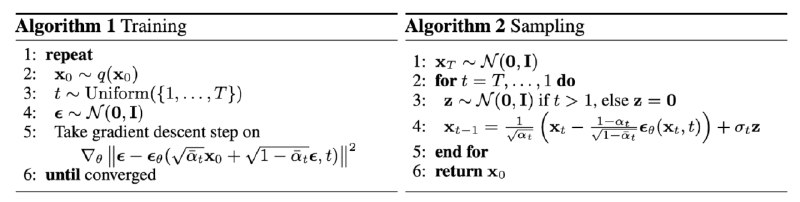

Today you see different generative models almost everywhere. The most visible example is text-to-image/video models, which generate a picture or a video from a text description. Let's dive into the terms diffusion and flow matching and see how all of this works at a high level.

## Diffusion

### Background

**DDPM** (Denoising Diffusion Probabilistic Models) was one of the main discoveries of 2020. After it, researchers started working on diffusion seriously and somewhat dropped GANs, even though there were a lot of GAN papers at the time.

I remember that moment well. I worked at Huawei on image quality enhancement, and in the neighbouring teams people slowly started to pay attention to normalizing flows and diffusion. We were training U-Net-like architectures and did not get distracted by anything else.

### The problem of generating data

So what is the point. To generate data, it would be great to know how the data is distributed, ideally to have access to the distribution function. To generate/sample something, you need this function.

For example, if you have a normal distribution (a bell) with a known mean and variance, you can easily sample data from it.

But what about high-dimensional images? The answer is: you can't, but... You cannot get the distribution of images, but you can try to model/approximate it.

### The main idea of diffusion models

As I said, we know how to sample from a normal distribution (aka noise). Now let's train a neural network to turn our noise into some data (for example, images).

Take noise, run the model, get an image. That simple. It may sound a bit strange, but this is how VAEs and GANs work.

### What is special about diffusion?

The main difference is that we transform noise into data in several steps instead of one. So we teach the model to move gradually. Here are 1000 steps: slowly turn the noise into an image.

And it works simply and well! It solves the blurry generations of VAEs and the unstable training of GANs. Yes, the process got slower, but in return we got stability and quality, and training itself became much simpler.

### How it works in more detail



DDPM has two processes, forward and reverse:
- In the forward process we add noise to an image, gradually turning it into noise
- In the reverse process we gradually denoise, turning it into an image

There are different noise schedules, and they affect the speed and quality of generation.

### How we teach the model to denoise

```python
def ddpm_train_step(self, x0):
    """
    x0 - original data
    """
    batch_size = x0.shape[0]
    # Pick a random time step
    t = torch.randint(0, timesteps, (batch_size, 1))
    # Add noise to the original data
    x_t, target_noise = add_noise(x0, t)
    # The model predicts the added noise
    predicted_noise = model(x_t, t)
    # Teach the model to predict it correctly
    loss = F.mse_loss(predicted_noise, target_noise)
    return loss
```

The main thing to notice: the process is stochastic. Even during generation we add noise at every step. And as paradoxical as it sounds, this noise sort of cancels out small errors of the model. If the model took a wrong turn at some step, the added noise can smooth out the effect. This is my understanding. If you think otherwise, write to me, let's discuss.

I hope this was useful. For a deeper dive, read this excellent 80-page guide: [Tutorial on Diffusion Models for Imaging and Vision](https://arxiv.org/abs/2403.18103).

## Flow matching

Remember, with DDPM we needed 1000 steps to generate. What if I tell you that you can do the same thing, but much simpler and faster?

Now let's talk about flow matching in its simplest form, linear interpolation. If DDPM seemed complicated, you will be amazed how simple this is.

**What is the main idea?** Instead of teaching the model to remove noise step by step (as in DDPM), we teach it to find the straight path from noise to the image. Yes, we just draw a line from point A to point B!

**How it works:**

1. Take noise and a real image
2. Randomly pick a point between them (this is our t)
3. Ask the model to predict which direction to move from this point

And that's it! Honestly, this is the whole algorithm. Look how simple the training code is:

```python
def train_step(self, x0):
   batch_size = len(x0)
   z = torch.randn(batch_size, self.dim).to(self.device)
   t = torch.rand(batch_size, 1).to(self.device)
   xt = (1 - t) * z + t * x0  # linear interpolation between noise and image
   pred_field = self.vector_field(xt, t)

   true_field = x0 - z  # here it is: the direction from noise to image
   loss = F.mse_loss(pred_field, true_field)
   return loss  # return the loss, not x
```

And generation is even simpler: just take small steps in the right direction:

```python
def sample(self, batch_size=64, steps=100):
    dt = 1.0 / steps
    x = torch.randn(batch_size, self.dim).to(self.device)
    for i in range(steps):
       t = torch.ones(batch_size, 1).to(self.device) * i * dt
       v = self.vector_field(x, t)
       x = x + dt * v
    return x
```

Now the most interesting part: what we do here is basically solving an ordinary differential equation!

Our vector_field is just the derivative dx/dt, and in sample we use the Euler method to solve this ODE. This opens a whole field for experiments: you can use any solver, Runge-Kutta, multistep methods and other things from numerical methods.

So take any solver from scipy.integrate and go! Some of them let you cut the number of generation steps even more.

**Main advantages over DDPM:**

- No need to fiddle with noise schedules
- The process is fully deterministic (we are just solving an ODE!)
- Generation is many times faster
- The code is so simple you can write it in 5 minutes

I was amazed myself when I first ran it: on many tasks the quality is comparable to DDPM, with three times less code.

The only small downside: the model can sometimes be less stable in training, because there is no stochasticity like in DDPM. But you fix this by choosing the right learning rate.

[Flow Matching Guide and Code](https://arxiv.org/abs/2412.06264)
