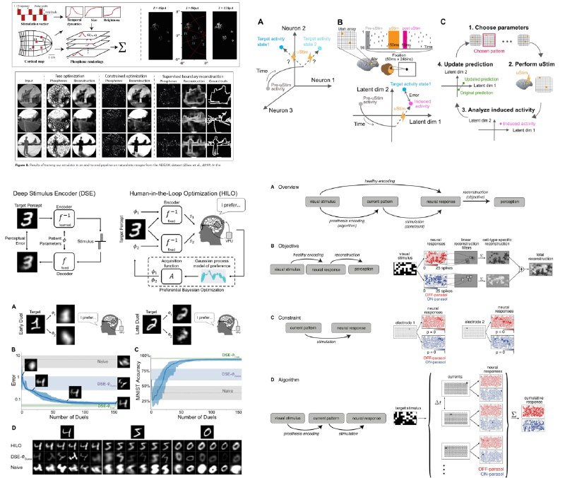

I already wrote that I started working on visual cortical implants. For many years this field has used the same standard stimulation patterns: usually 10–50 pulses through several electrodes over 100–200 ms. This approach is far from natural brain activity, but it reliably produces phosphenes.

I think this technology can be improved a lot. For example, track neural activity during stimulation and adapt the parameters in real time. Or use direct feedback from the patient for iterative optimization. Now is the perfect time to push this field: make stimulation more natural, use multi-electrode arrays, and build closed-loop systems with neural feedback.

I prepared a review of four important papers in this area.

[Towards biologically plausible phosphene simulation](https://doi.org/10.7554/eLife.85812): uses an in silico model of V1 cortex to build a differentiable phosphene simulator.

[Human-in-the-Loop Optimization](http://arxiv.org/abs/2306.13104): on synthetic retinal prosthesis data, a method compresses thousands of stimulation parameters to 13 via Bayesian optimization.

[MiSO: Optimizing brain stimulation](https://openreview.net/forum?id=Gb0mXhn5h3): on real Utah array recordings (96 electrodes) from macaque PFC, a system that predicts neural states from multi-electrode stimulation.

[Precise control with dynamically optimized electrical stimulation](https://doi.org/10.7554/eLife.83424): on ex vivo mouse retina, a temporal dithering algorithm (stimulate with small delays).

## Towards biologically plausible phosphene simulation

tl;dr: Differentiable PyTorch simulator translating V1 stimulation to phosphene perception for end-to-end optimization
- Fully differentiable pipeline allowing optimization of all stimulation parameters via backpropagation
- Based on many experimental data.
- Bridges gap between electrode-level stimulation and resulting visual perception

link: https://doi.org/10.7554/eLife.85812

## Human-in-the-Loop Optimization for Visual Prostheses

tl;dr: Neural encoder + Preference bayesian optimization.
- Train deep stimulus encoder (DSE): transform images -> stimulation.
- Add "patient params" 13 values as additional input into DSE.
- Uses Preferential Bayesian Optimization with GP prior to update only "patients" params using only binary comparisons
- Achieves 80% preference alignment after only 150 comparisons despite 20% simulated noise in human feedback

link: https://arxiv.org/abs/2306.13104

## MiSO: Optimizing brain stimulation for target neural states

tl;dr: ML system that predicts and optimizes multi-electrode stimulation to achieve specific neural activity patterns
- Utah array on monkey PFC
- One-two electrode stimulation with fixed frequency/amplitude
- Collect paired (stim, signals) data across multiple sessions
- Extract latent features using Factor Analysis (FA)
- Align latent spaces across sessions using Procrustes method
- Train CNN to predict latent states from stim patterns
- Apply epsilon-greedy optimizer to find optimal stimulation in closed-loop

link: https://www.nature.com/articles/s41467-023-42338-8

## Precise control with dynamically optimized electrical stimulation

tl;dr: Temporal dithering algorithm exploits neural integration window to enhance visual prosthesis performance by 40%
- Uses triphasic pulses at 0.1ms intervals optimized within neural integration time window (10-20ms)
- Implements spatial multiplexing with 200μm exclusion zones to prevent electrode interference
- Achieves 87% specificity in targeting ON vs OFF retinal pathways, solving a fundamental limitation of current implants

link: https://doi.org/10.7554/eLife.83424

## My thoughts
The field is finally moving beyond simplistic zap-and-see approaches. These papers tackle predicting perception, minimizing patient burden, targeting neural states, and improving power efficiency. What excites me most is how these methods could work together - imagine MiSO's targeting combined with human feedback and efficient stimulation patterns. The missing piece? Understanding how neural activity translates to actual perception. Current approaches optimize for either brain patterns OR what people see, not both. I think the next breakthrough will come from models that bridge this gap, perhaps using contrastive learning to connect brain recordings with what people actually report seeing.
