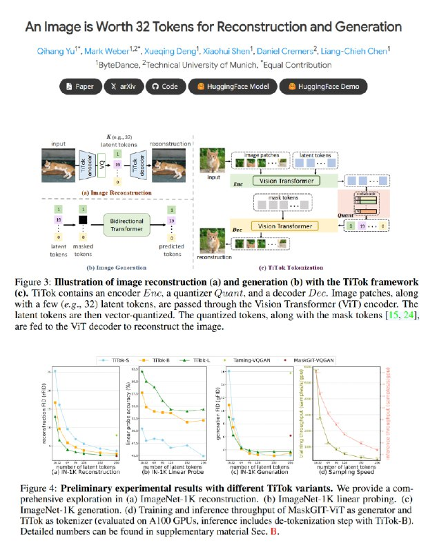
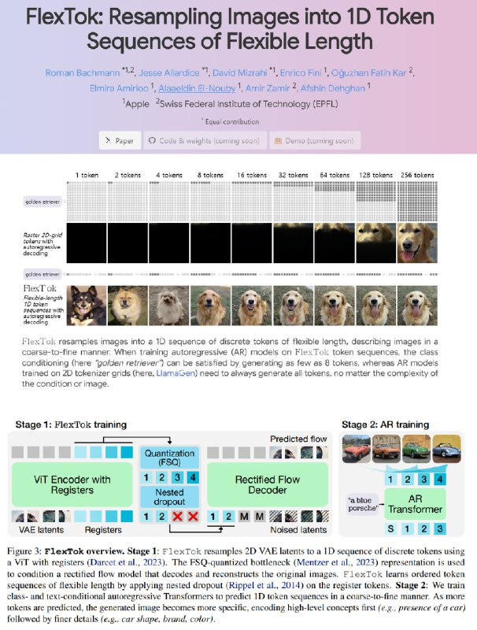
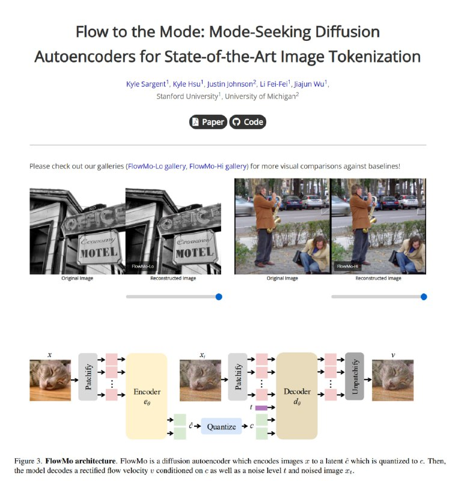

For years, people used different kinds of autoencoders to compress images. To get a discrete representation (a set of specific "symbols" instead of continuous values), they used VQ-VAE: a regular autoencoder with a vector-quantized layer in the middle.

In mid-2024 transformers reached this area too.

The main idea:

1. Replace convolutions with transformers.
2. Drop the 2D grid and represent an image as a plain sequence of tokens, with no explicit spatial position for each token.

## TiTok: An Image is Worth 32 Tokens

Paper: [arxiv.org/abs/2406.07550](https://arxiv.org/abs/2406.07550)

The main point: 32, 64 or 128 tokens are enough to represent a whole image.

How it works:

- The encoder and the decoder are both Vision Transformers.
- Special register tokens are added to the image patches.
- The register tokens are quantized: each becomes a vector from a codebook.
- These tokens go into the decoder together with [MASK] tokens.

This architecture is similar to MAE (Masked Autoencoder), but the focus is on a compact representation.

For generation they use MaskGIT, and the images are quite good. No diffusion: everything is fast and simple.

Linear probing accuracy drops as the number of tokens goes up, so there is a trade-off between compression and feature quality.

## FlexTok: flexible token length

Paper: [arxiv.org/abs/2502.13967](https://arxiv.org/abs/2502.13967)

FlexTok takes the TiTok idea, but starts from VAE latents instead of the original image:

- It adds flow matching for the decoder.
- The registers are the condition for the decoder.
- Nested dropout on the registers lets the decoder work with any number of tokens, from 1 to 256.
- It uses FSQ quantization, like COSMOS by NVIDIA.

## FlowMO: the direct approach

Paper: [arxiv.org/abs/2503.11056](https://arxiv.org/abs/2503.11056)

FlowMO is TiTok with a diffusion decoder:

- It works directly with images.
- It uses all tokens for reconstruction.
- The decoder is diffusion, like in FlexTok.

## Comparison

| Model   | Works with  | Diffusion decoder | Distillation       | Quantization                  |
| ------- | ----------- | ----------------- | ------------------ | ----------------------------- |
| TiTok   | Raw images  | No                | Via MagViT VQ-VAE  | Standard VQ                   |
| FlexTok | VAE latents | Yes               | No                 | FSQ, 64k vectors              |
| FlowMO  | Raw images  | Yes               | No                 | LFQ (sign) with complex losses |

## My thoughts on where this can go

Combine MAE with TiTok:

- Mask the input image, as in MAE. In theory this should make training faster and the tokens even more informative.

Combine FlexTok, TiTok and MAE into one universal feature extractor:

- Random masking of the input image (0, 0.25, 0.5, 0.75, 1).
- Nested dropout for the latents, as in FlexTok.
- Token masking for the decoder (0.5, 0.75, 1), as MaskGIT already does.
- Plus REPA on top.
