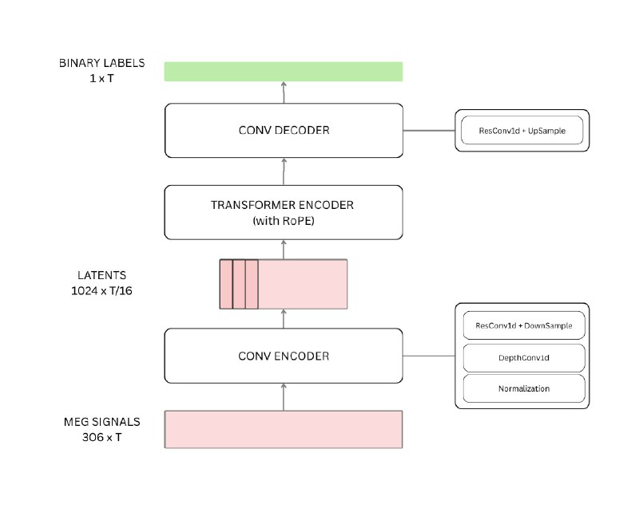
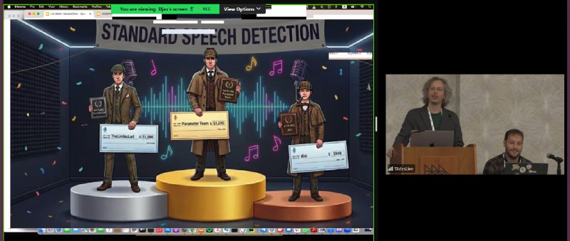

A couple of days ago the organizers announced the results of the competition. We took third place in the speech detection track with 91% F1-macro and won $800 🥳

Team (alvi team): Aleksandr Kovalev, Alexey Timchenko, Petr Chizhov, Vlad Lomtev.
[Our GitHub](https://github.com/kovalalvi/alvi-libribrain-2025) · [the competition](https://neural-processing-lab.github.io/2025-libribrain-competition/leaderboard/speech_detection_standard/)

Today I'll tell you what surprised us, what worked and what didn't. First, a quick reminder of the task. A person sits and listens to an audiobook about Sherlock Holmes, and their brain activity is recorded with MEG at the same time. From this activity you need to predict whether the person hears speech or silence at every moment.

## Data
The main insight: we spent a couple of weeks on the right normalization. Always look at the distributions in train/val/test to understand what you are dealing with. We used a global robust z-score (median + MAD instead of mean + std). Important: compute the statistics only on train and apply them everywhere. The organizers' default computed them separately on each split, and it worked much worse.

Per-session normalization is a separate story. It gave the best result on val, but on the holdout we didn't know which sessions were there (the organizers concatenated several), so in the end we chose global normalization.

## Architecture
For neural data, what works for audio still works great. Convolutions + transformer beat both a pure transformer and pure convolutions. The architecture is in the picture.

A few things gave a boost. (1) A norm layer with a learnable scale for each channel (+1.5%). Here we did a z-score inside the window for each electrode. (2) A depth-wise conv as the first layer (first convolutions separately for each channel, then mixing). (3) Weight averaging: we averaged the model weights from the last 3 checkpoints. We tuned the number on val. We didn't expect it to work, but it really gave +1% on test.

## What didn't work
Augmentations gave nothing for the final model; we tried masking and noise. MAE pretraining didn't work either, but we trained on small windows (256). It seems we need to try larger ones; I believe it should work. At the end we tried to expand the dataset with generation, and even trained a conditional DiT for it. No gain.

p.s. First place had 91.6%, so we were close.
