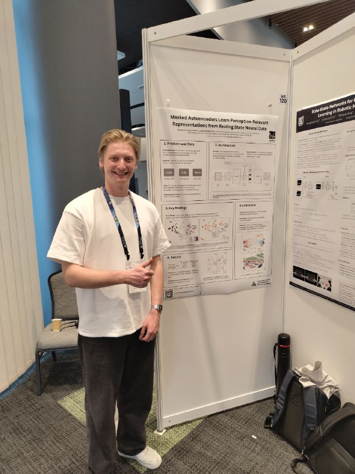
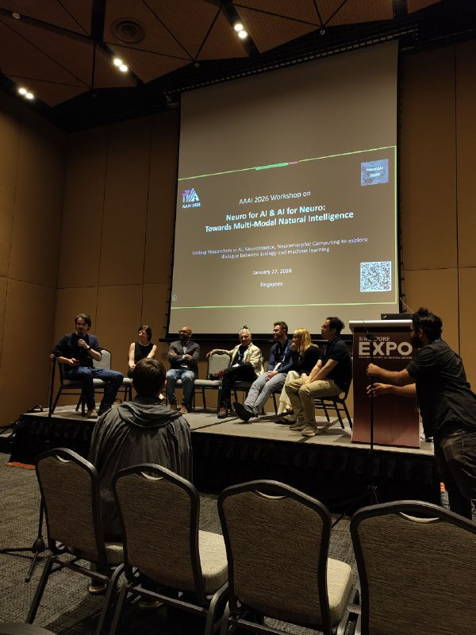
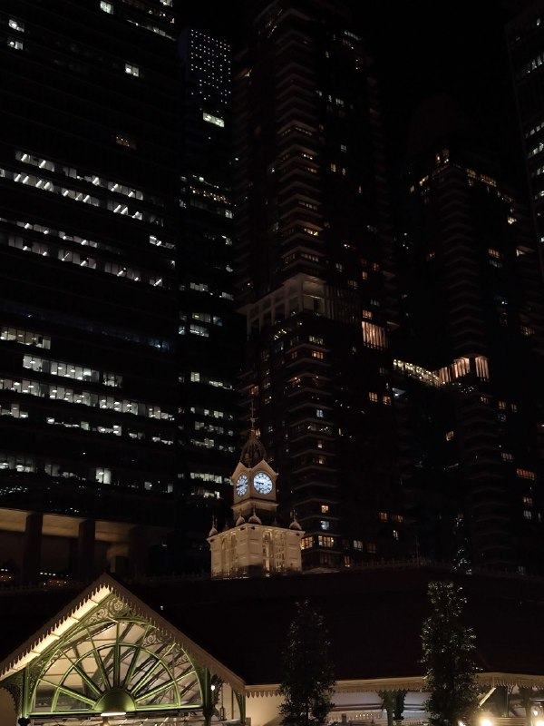
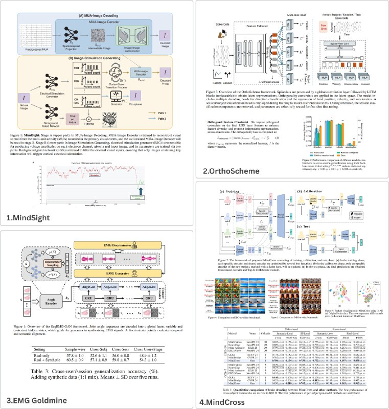

I went to my first AI conference. I presented our work on visual implants at the AI for Neuro workshop, talked to a lot of people and listened to talks. Here is how it went.

After a year in Elche (a small town in the south of Spain), Singapore is impressive. Everything shines, everything is big. But around the corner from the skyscrapers there are Hawker Centers and Chinatown: dirty, noisy, tasty. The food is great, and the weather is a constant 30 degrees.

## The conference
Almost 5000 accepted papers. Huge hangars with posters, impossible to see everything. Honestly, the technical sessions and invited talks didn't really work for me. Some were too general, and at the technical sessions many speakers just read from a sheet. It is much more useful to walk up to a poster and talk to the author directly. There you can ask real questions and discuss the work. I also unexpectedly met a lot of people from Russia. They work on many things: RL, pipelines for agents, NAS, weather prediction and of course generative AI.

Another interesting thing: I got talking with Chinese researchers who do motor decoding in monkeys. It turned out that in Beijing alone there are now 4 labs doing this and competing with each other. So there will be many more BCI papers from China in the coming years.

## The AI for Neuro workshop
The main event for me. It was organized by Reza Abbasi-Asl and his team, and organized very well. Of the speakers, Andreas Tolias (Stanford) and Martin Schrimpf (EPFL) hooked me the most. Both said the same thing: stop playing with small models, it's time to scale.

A line from Tolias that stuck with me:
"We don't have a choice. We should stop doing toy experiments. Train big models."

He showed his foundation model of the visual cortex, trained on data from ~135,000 neurons in 14 mice. When transferred to a new animal it needs 2–3 times less data than training from scratch. So you can really run experiments in silico instead of collecting data from scratch every time. Daria Kleeva's channel has a [detailed breakdown](https://t.me/skigeon/205).

Schrimpf showed TopoLM, a transformer where units have a 2D position, like neurons in the cortex. During training the model organizes itself into clusters that resemble the brain's language areas. I liked it because the idea is simple: add a spatial loss and get a brain-like organization. His lab also has a paper on scaling laws for brain-aligned vision models, with essentially the same message: scale works.

## My poster
I presented "Masked Autoencoders Learn Perception-Relevant Representations from Resting State Neural Data" at the workshop poster session. In short: we take resting-state data (the brain just "hums", no stimulation), pretrain a model on it, and after that it better predicts what a person perceives when the visual implant stimulates.

## Plans
While we prepare for the next patient to be implanted with electrodes, we want to collect as much data as possible, including from monkeys, and finally scale the models properly. The main pain: data drift between sessions, and a model from one patient is very hard to transfer to another.

## Tasty AAAI-26 papers

### MindSight
[MindSight: Bio-Inspired Neural Architecture for Visual Restoration via Cortical Electrical Stimulation](https://doi.org/10.1101/2025.11.12.688136)

**tl;dr:** the system learns to generate voltage patterns on electrodes to create the desired visual percepts through cortical stimulation. Tested on real macaques.

Recording from 1280 V1 channels, decoding from 50 ms MUA windows, predicting the current for each electrode. Two training paths: through an MUA decoder and through a phosphene simulator. At least 16 channels must activate together per electrode (found via saccade experiments). Blindfolded macaques tell shapes apart at the level of normal vision and walk around obstacles.

💬 Probably the most unusual work at the conference. Not a simulation, not "we showed it is possible in principle", but a real thing that works in primates. 1280 channels is a serious scale, and the fact that the macaques actually navigate and tell shapes apart is already a bit more than a proof of concept.

### Orthogonal representations
[Multi-dimensional Neural Decoding with Orthogonal Representations](https://arxiv.org/abs/2508.08681)

**tl;dr:** regularization through orthogonality of the latent space for decoding movements. Utah array, macaque motor cortex; they decode direction, position, velocity and acceleration at the same time.

An orthogonality loss splits the latent into pieces, one per movement parameter. There is a session classification head; at transfer, its weights are used to throw out session features. Cross-session 2-shot direction accuracy 72.6% → 80.2%, cross-subject R² for velocity 0.592 → 0.653. Ablation: only the combination of orthogonalization and the session head gives the effect; each alone gives almost nothing.

💬 I talked with Kaixi at the conference, but I still didn't fully get why to classify the session. To me it is more logical to anti-classify, that is, explicitly remove all session information from the representations and do it during training, not after. Either way the direction is right: session drift is one of the main problems in BCI.

### MindCross
[MindCross: Fast New Subject Adaptation for Cross-subject Video Reconstruction from Brain Signals](https://arxiv.org/abs/2511.14196)

**tl;dr:** video reconstruction from brain signals with fast adaptation to a new subject. They split the latent into subject-specific and subject-agnostic parts.

One shared encoder + N subject-specific encoders. The specific part handles the patient's peculiarities, the shared part the semantics of the video. When adapting to a new subject, only their specific encoder is trained.

💬 I'd do exactly the opposite. The shared encoder should give session-specific information, and the individual encoders session-invariant features. Every person's brain is unique, and it is the individual encoder that should map this unique topology into a shared semantic space. Even better: use a LoRA for each participant and **train a meta-model that generates LoRA weights from a new subject's resting state.**

### Synthetic EMG
[New Synthetic Goldmine: Hand Joint Angle-Driven EMG Data Generation](https://arxiv.org/abs/2509.23359)

**tl;dr:** generating synthetic EMG data from finger movements to improve gesture classification. The model solves the inverse problem: it invents muscle activity for a given gesture. +2–3% accuracy.

💬 I tried to make synthetic data work several times, for both EMG and MEG. Generation worked, but it gave no gain in quality. This paper proves once again that my hands just grew from the wrong place and I need to try again!
