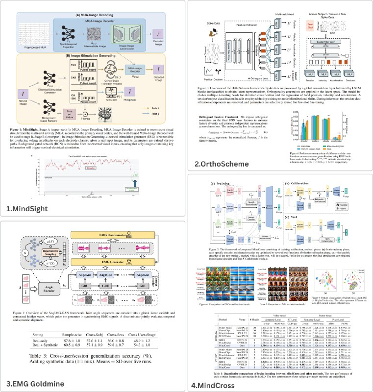

## MindSight
[MindSight: Bio-Inspired Neural Architecture for Visual Restoration via Cortical Electrical Stimulation](https://doi.org/10.1101/2025.11.12.688136)

**tl;dr:** the system learns to generate voltage patterns on electrodes to create the desired visual percepts through cortical stimulation. Tested on real macaques.

Recording from 1280 V1 channels, decoding from 50 ms MUA windows, predicting the current for each electrode. Two training paths: through an MUA decoder and through a phosphene simulator. At least 16 channels must activate together per electrode (found via saccade experiments). Blindfolded macaques tell shapes apart at the level of normal vision and walk around obstacles.

💬 Probably the most unusual work at the conference. Not a simulation, not "we showed it is possible in principle", but a real thing that works in primates. 1280 channels is a serious scale, and the fact that the macaques actually navigate and tell shapes apart is already a bit more than a proof of concept.

## Orthogonal representations
[Multi-dimensional Neural Decoding with Orthogonal Representations](https://arxiv.org/abs/2508.08681)

**tl;dr:** regularization through orthogonality of the latent space for decoding movements. Utah array, macaque motor cortex; they decode direction, position, velocity and acceleration at the same time.

An orthogonality loss splits the latent into pieces, one per movement parameter. There is a session classification head; at transfer, its weights are used to throw out session features. Cross-session 2-shot direction accuracy 72.6% → 80.2%, cross-subject R² for velocity 0.592 → 0.653. Ablation: only the combination of orthogonalization and the session head gives the effect; each alone gives almost nothing.

💬 I talked with Kaixi at the conference, but I still didn't fully get why to classify the session. To me it is more logical to anti-classify, that is, explicitly remove all session information from the representations and do it during training, not after. Either way the direction is right: session drift is one of the main problems in BCI.

## MindCross
[MindCross: Fast New Subject Adaptation for Cross-subject Video Reconstruction from Brain Signals](https://arxiv.org/abs/2511.14196)

**tl;dr:** video reconstruction from brain signals with fast adaptation to a new subject. They split the latent into subject-specific and subject-agnostic parts.

One shared encoder + N subject-specific encoders. The specific part handles the patient's peculiarities, the shared part the semantics of the video. When adapting to a new subject, only their specific encoder is trained.

💬 I'd do exactly the opposite. The shared encoder should give session-specific information, and the individual encoders session-invariant features. Every person's brain is unique, and it is the individual encoder that should map this unique topology into a shared semantic space. Even better: use a LoRA for each participant and **train a meta-model that generates LoRA weights from a new subject's resting state.**

## Synthetic EMG
[New Synthetic Goldmine: Hand Joint Angle-Driven EMG Data Generation](https://arxiv.org/abs/2509.23359)

**tl;dr:** generating synthetic EMG data from finger movements to improve gesture classification. The model solves the inverse problem: it invents muscle activity for a given gesture. +2–3% accuracy.

💬 I tried to make synthetic data work several times, for both EMG and MEG. Generation worked, but it gave no gain in quality. This paper proves once again that my hands just grew from the wrong place and I need to try again!
