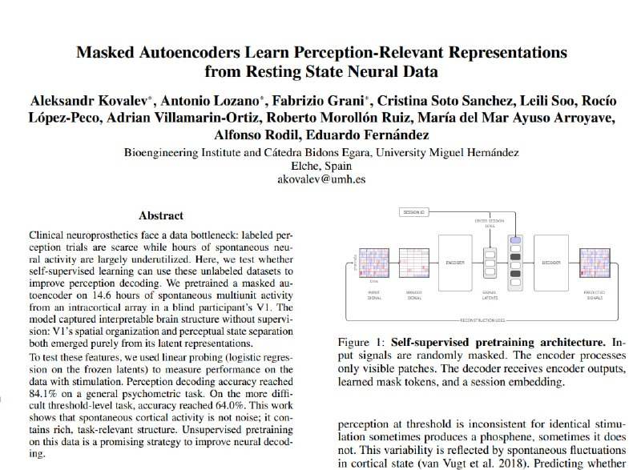

tl;dr: we pretrain an MAE on 14.6 hours of spontaneous activity from V1 of a blind patient with a Utah array, and from the neural response to stimulation we decode whether the person sees a phosphene or not. Real patient data.

I finally got around to writing a short review of my AAAI-26 paper. I already shared the poster, and now it has made it to arXiv too.

So, we work with Utah array signals from V1 of blind people: we can both stimulate and record. It would be great not to ask the person every time whether they see something, but to understand it directly from the neural response to stimulation. Plus we have accumulated a lot of spontaneous activity: 252 sessions, 14.6 hours of recordings from 96 channels. So the question is: can we pretrain a model on this data so that it helps tell whether the person sees or not.

## Model
I took MAE as the base. By the way, my very first paper review was about this exact model, many years ago. I trained it and saw lots of clusters by session in the latents, which doesn't fit the task at all: we want to tell whether the person sees or not, not guess on which day the recording was made. So I added a second loss, basically a sigmoid loss like in SigLIP, but the other way around: I pull together features from different sessions and push apart features from the same session. Plus I feed the session embedding to the decoder as a separate token: all session information goes there, and the encoder simply has no reason to keep it in the latents. The latent space started to look much better, and the metrics went up.

## Results
On top of the frozen encoder we train a plain logistic regression. On the psychometric task we get 84.1% versus 80.2% on raw MUA and 82.4% on PCA. Looking ahead, the latents also show which electrode was stimulated and with what current: neighbouring electrodes cluster together, hello retinotopy. But the most interesting one is the threshold task: same electrode, current fixed at the 50% threshold, the person sometimes sees a phosphene and sometimes not. Even here we decode perception at 64% versus 60% on raw data.

So I finally closed this one and shared it. I had been meaning to for several weeks and never got to it.

## Next step
Turn this into a full paper: train on several people and run proper ablations. Hopefully it works out, and then it goes somewhere like the Journal of Neural Engineering.

Paper: Kovalev*, Lozano*, Grani* et al. [Masked Autoencoders Learn Perception-Relevant Representations from Resting State Neural Data](https://arxiv.org/abs/2607.22615). NeuroAI Workshop @ AAAI 2026.
