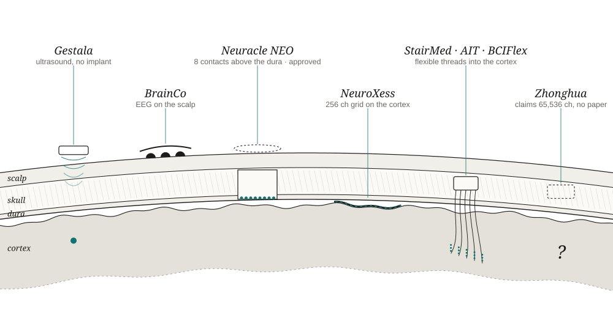

Recently Bashar Badran from the Chinese startup Gestala visited us. He used to work at Neuralink, and now he runs clinical and science there. He told us how strong neurotech in China is right now. At AAAI I also talked a lot with a colleague from a BCI lab in Beijing. Then I got sick, stayed at home and finally decided to figure out what is really going on there.

First thing I found: on March 13, 2026 China approved NEO by Neuracle, the world's first implantable brain-computer interface as a product. 9 days later it got an insurance billing code, 11 days later it was on public procurement lists ([MIT Tech Review](https://www.technologyreview.com/2026/06/01/1138133/china-world-first-brain-chip/)).

Then I found out that in China a hospital can start a human study of an implant by itself. Lab tests, materials and large-animal studies are still required ([example](https://ccj.pku.edu.cn/Article/DownLoad?id=797921449017413&type=ArticleFile)), but the hospital reviews them, and since May 2026 the National Health Commission only gets a notification and can stop the study later ([NHC](https://www.nhc.gov.cn/qjjys/c100015/202604/1c2cca29daef42509e8ffd9ddf9c64fd.shtml)). In the US, the FDA reviews all of this before the start.

And money. In 2025 Chinese BCI raised $114M, in 2026 already $922M, almost the same as the US with $932M ([New Market Pitch](https://newmarketpitch.com/blogs/news/brain-computer-interface-funding-trends)).

Now the companies.

How deep each device goes. The vision implants are in their own section below.

## Invasive

### [Neuracle](https://www.neuracle.cn)

<dl><dt>Where</dt><dd>Shanghai</dd><dt>Founded</dt><dd>2011</dd><dt>Raised</dt><dd>not public (valuation ~$595M)</dd><dt>Last round</dt><dd>$45M (11.2025), preparing an IPO</dd><dt>Data</dt><dd>preprint, one patient</dd></dl>

**what:** the first approved implant, NEO. For people with tetraplegia after a neck injury: close and open the hand.
- Basically 8 contacts on top of the dura, nothing goes into the cortex. No battery, it works while a coil sits on the head. An external computer decodes and inflates a glove on the hand
- One patient: F1 0.91 over 9 months at home ([medRxiv](https://www.medrxiv.org/content/10.1101/2024.09.05.24313041)). My first thought was that EEG has done the same for years. I found a similar patient: ~70% accuracy after a year of training ([Rohm 2013](https://doi.org/10.1016/j.artmed.2013.07.004)). Different metrics, but the gap is clear
- A kit costs $71k, 13 sold since July. No paper yet on the 32 patients from the trial

### [StairMed](https://www.stairmed.com/en)

<dl><dt>Where</dt><dd>Shanghai</dd><dt>Founded</dt><dd>2021</dd><dt>Raised</dt><dd>$387M</dd><dt>Last round</dt><dd>~$208M (H2 2026), preparing an IPO</dd><dt>Data</dt><dd>paper on recording, not decoding</dd></dl>

**what:** the closest to Neuralink: flexible electrodes that actually go into the cortex, 256 channels.
- 42 implants, by their count already more than Neuralink
- cursor 6.5 bits/s, but this is the company's number
- there is a paper, but about single-neuron recording, not decoding ([Nat Comms](https://www.nature.com/articles/s41467-026-71443-7)). Waiting for a decoding paper

### [NeuroXess](https://www.neuroxess.com)

<dl><dt>Where</dt><dd>Shanghai</dd><dt>Founded</dt><dd>2021</dd><dt>Raised</dt><dd>~$168M</dd><dt>Last round</dt><dd>$104M (10.2026)</dd><dt>Data</dt><dd>peer-reviewed decoding paper</dd></dl>

**what:** basically a Chinese Precision. A flexible micro-ECoG grid sits on the cortex and does not penetrate it. 256 channels vs 1024 at Precision, but they have a fully implanted version with a battery.
- 65 clinical cases, now a registration trial in 16 hospitals
- Mandarin speech: 394 syllables, median 71.2% ([Science Advances](https://doi.org/10.1126/sciadv.adz9968)). By the way, Li Yuanning is a co-author there, he shows up again below

### NeuCyber / Beinao

<dl><dt>Where</dt><dd>Beijing</dd><dt>Founded</dt><dd>2023</dd><dt>Raised</dt><dd>~$30M from the Beijing government</dd><dt>Last round</dt><dd>no private rounds</dd><dt>Data</dt><dd>numbers from the institute only</dd></dl>

**what:** a state project of the Beijing brain institute [CIBR](https://www.cibr.ac.cn).
- Beinao-1 sits above the dura, 128 channels, decodes ~100 Chinese words. 40+ patients, but the numbers differ between sources
- Beinao-2 is intracortical, 512 channels, promised in humans by the end of 2026

**New wave of intracortical startups.** Lots of money, no clinical data at all:

<h4><a href="https://www.aitbci.com">AIT</a></h4><dl><dt>Where</dt><dd>Shanghai</dd><dt>Founded</dt><dd>2026</dd><dt>Raised</dt><dd>~$118M</dd><dt>Last round</dt><dd>$69M (11.2026)</dd><dt>Data</dt><dd>no human data</dd></dl>
Active Intelligence Technologies. A record for an angel round. Ultra-flexible electrodes, 1024 channels

<h4><a href="https://www.bciflex.com">Zhiran / BCIFlex</a></h4><dl><dt>Where</dt><dd>Beijing</dd><dt>Founded</dt><dd>2022</dd><dt>Raised</dt><dd>$93M</dd><dt>Last round</dt><dd>$45M (02.2026)</dd><dt>Data</dt><dd>no human data</dd></dl>
Ultra-thin flexible electrodes

<h4>Zhonghua</h4><dl><dt>Where</dt><dd>Wuhan</dd><dt>Founded</dt><dd>2021</dd><dt>Raised</dt><dd>no rounds</dd><dt>Last round</dt><dd>funded personally by the chairman of Guide Infrared</dd><dt>Data</dt><dd>no paper</dd></dl>
Claims 65,536 channels, “20x more than Neuralink”

## Vision

This is the most interesting part for me: we work with a Utah array in V1 of a blind participant ourselves.

### Mindtrix

<dl><dt>Where</dt><dd>Suzhou (one source)</dd><dt>Founded</dt><dd>2024</dd><dt>Raised</dt><dd>&gt;$74M in 2026</dd><dt>Last round</dt><dd>pre-A+ (11.2026)</dd><dt>Data</dt><dd>company claims, one sighted patient</dd></dl>

**what:** visual cortex stimulation, 1024 channels.
- Data so far from one sighted patient with epilepsy, an acute experiment. He saw "shapes and colors", phosphene positions matched in 95% of cases, according to the company
- No paper, no video. The first blind patient is promised in 2027

### Xinsheng Shijie

<dl><dt>Where</dt><dd>Beijing</dd><dt>Founded</dt><dd>2026</dd><dt>Raised</dt><dd>~$15M</dd><dt>Last round</dt><dd>seed (06.2026)</dd><dt>Data</dt><dd>preclinical</dd></dl>

**what:** also a cortical visual prosthesis, still preclinical. Their co-founder is the same [Li Yuanning](https://yuanningli.github.io) from the NeuroXess paper, a former postdoc of Edward Chang.

### [NanoChap](https://www.nanochap.com)

<dl><dt>Where</dt><dd>Hangzhou</dd><dt>Founded</dt><dd>2014</dd><dt>Raised</dt><dd>~$149M</dd><dt>Last round</dt><dd>$74M (11.2026)</dd><dt>Data</dt><dd>clinical trial, no paper yet</dd></dl>

**what:** a retinal implant, 320 channels, already in a clinical trial.
- a woman who had not seen for ~20 years recognizes some letters and writes the word "China" in Chinese characters
- a 1280-channel cortical version is still in development

Europe for comparison:

- **[ReVision Implant](https://www.revision-implant.com/) · Leuven · 2020 · last round $4.5M (05.2026)**. Cortical prosthesis. They plan the first clinical study in humans in our lab at the end of 2027
- **[Phosphoenix](https://www.phosphoenix.nl) · Amsterdam · last round $1.5M (09.2026)**. They stimulate the LGN, not the cortex

## Non-invasive

### [BrainCo](https://www.brainco.tech)

<dl><dt>Where</dt><dd>Hangzhou and Boston</dd><dt>Founded</dt><dd>2015</dd><dt>Raised</dt><dd>~$370M</dd><dt>Last round</dt><dd>$286M (01.2026)</dd><dt>Data</dt><dd>products on sale</dd></dl>

**what:** EEG headbands, a bionic hand on sEMG and hands for humanoids. The Hong Kong IPO was postponed.

### [Gestala](https://www.gestala.com)

<dl><dt>Where</dt><dd>Chengdu and Shanghai</dd><dt>Founded</dt><dd>2026</dd><dt>Raised</dt><dd>$85M in six months</dd><dt>Last round</dt><dd>~$63M (07.2026)</dd><dt>Data</dt><dd>company numbers, 30+ cases</dd></dl>

**what:** ultrasound without an implant plus a brain foundation model.
- first indication: chronic pain, 30+ cases
- the same Bashar joined them from Neuralink in April 2026, where he led clinical partnerships ([Gestala](https://www.gestala.com/news/15))

## My thoughts

Time to move to China 😅

OK, seriously: China invests a lot in neurotech. There is both private and state money. The regulator makes it easier to test new technologies in humans, so you can work with a hospital directly. It may look like there are not many papers and details, but we can say the same about American companies. In my view, this is fine. It is hard to demand papers in top journals from startups.

On vision: Mindtrix alone raised more than 10x what ReVision and Phosphoenix raised together in 2026. And the Europeans have no human data at all, while Mindtrix has at least one test (on a sighted patient, during a different procedure).

China is quickly becoming the second neurotech center in the world, right after the US. My prediction: in 5–10 years China can take first place by the number of implanted neural devices.
